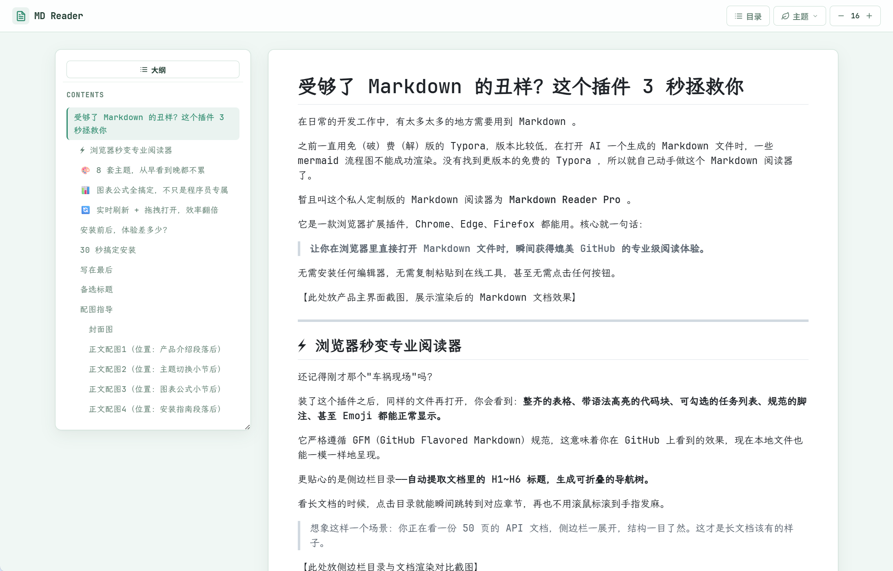

# 受够了 Markdown 的丑样？这个插件 3 秒拯救你

在日常的开发工作中，有太多太多的地方需要用到 Markdown 。

之前一直用免（破）费（解）版的 Typora，版本比较低，在打开 AI 一个生成的 Markdown 文件时，一些 mermaid 流程图不能成功渲染。没有找到更版本的免费的 Typora ，所以就自己动手做这个 Markdown 阅读器了。

暂且叫这个私人定制版的 Markdown 阅读器为 **Markdown Reader Pro** 。

它是一款浏览器扩展插件，Chrome、Edge、Firefox 都能用。核心就一句话：

> **让你在浏览器里直接打开 Markdown 文件时，瞬间获得媲美 GitHub 的专业级阅读体验。**

无需安装任何编辑器，无需复制粘贴到在线工具，甚至无需点击任何按钮。

## ⚡ 浏览器秒变专业阅读器

装了这个插件之后，会看到：**整齐的表格、带语法高亮的代码块、可勾选的任务列表、规范的脚注、甚至 Emoji 都能正常显示。**

它严格遵循 GFM（GitHub Flavored Markdown）规范，这意味着你在 GitHub 上看到的效果，现在本地文件也能一模一样地呈现。

更贴心的是侧边栏目录——**自动提取文档里的 H1~H6 标题，生成可折叠的导航树。**

看长文档的时候，点击目录就能瞬间跳转到对应章节，再也不用滚鼠标滚到手指发麻。

> 想象这样一个场景：你正在看一份 50 页的 API 文档，侧边栏一展开，结构一目了然。这才是长文档该有的样子。

## 🎨 8 套主题，从早看到晚都不累

有人偏爱清爽的白底黑字，有人喜欢深邃的暗色模式。

**这个插件准备了 8 套精美主题：Light / Paper / Mint / Vue / Dark / Night / Purple / Black。**

一键切换，系统明暗模式还能自动跟随。

早晨在明亮的办公室里，用 Light 主题清爽阅读；深夜加班赶文档，切到 Night 主题护眼看代码。**代码高亮的配色也会随主题同步切换**，不是那种"换了个皮但代码还是刺眼"的敷衍设计。

我自己最爱 Paper 主题，像在读一本排版精良的纸质书，舒服得让人想多看几页。

## 📊 图表公式全搞定，不只是程序员专属

很多人以为 Markdown 插件就是给程序员用的。

**但产品经理画流程图、学生写数学笔记、运营整理数据——谁不需要呢？**

这个插件内置了 **Mermaid 图表渲染**，流程图、序列图、甘特图、状态图、类图……统统能在浏览器里直接显示。点击图表还能放大查看，细节不遗漏。

同时支持 **KaTeX 数学公式**，行内公式 `$...$` 和块级公式 `$$...$$` 都能完美渲染。理工科的同学写论文、做笔记，终于不用为了看几个公式去开专门的编辑器了。

> **一个好的工具，不该区分"谁配用"。只要你需要阅读 Markdown，它就值得被安装。**

## 🔄 实时刷新 + 拖拽打开，效率翻倍

这两个功能是我每天用得最频繁的。

**实时刷新**：本地文件修改保存后，浏览器里的页面会自动重新渲染。**写文档的时候，编辑器在一边，浏览器在另一边，秒级同步**，再也不用反复刷新。

**拖拽预览**：直接把 `.md` 文件拖到浏览器窗口里，松开鼠标，立刻看到渲染后的效果。**连双击打开都省了。**

有时候同事发我一个文档，我直接拖到浏览器里就能看，比自己装一堆软件快多了。

## 安装前后，体验差多少？

| 场景 | Before（安装前） | After（安装后） |
|------|------------------|-----------------|
| 打开 README.md | 纯文本，表格全乱 | GitHub 级精美排版 |
| 看长文档 | 疯狂滚鼠标找章节 | 侧边栏目录一点即达 |
| 写文档预览 | 复制到在线工具 | 保存即刷新，浏览器秒同步 |
| 收到 Markdown 文件 | 先想"装什么软件打开" | 拖到浏览器，完事 |
| 深夜看文档 | 白屏刺眼 | 暗色主题，舒服护眼 |

**一句话总结：安装前，Markdown 是负担；安装后，Markdown 是享受。**

---

## 备选标题

1. **受够了 Markdown 的丑样？这个插件 3 秒拯救你** — 策略：痛点共鸣 + 数字冲击
2. **8 个主题 + 实时刷新：这才是 Markdown 该有的样子** — 策略：利益点堆叠 + 价值主张
3. **我开发了这款插件，让 Markdown 阅读体验直接碾压 GitHub** — 策略：个人背书 + 反常识对比

## 配图指导

### 封面图
- 推荐比例：2.35:1（公众号封面标准）
- 视觉风格：扁平插画，科技感与亲和力兼具
- 生成 prompt：一个现代化的浏览器窗口中展示着排版精美的 Markdown 文档，旁边有侧边栏目录，整体采用蓝紫渐变色调，扁平插画风格，背景干净简洁，右侧留出文字空间，专业感与友好感并存

### 正文配图1（位置：产品介绍段落后）
- 作用：展示产品主界面，让读者直观感受效果
- 生成 prompt：电脑屏幕截图风格，浏览器中打开一份排版精美的 Markdown 文档，包含代码块、表格、列表，界面干净整洁，Light 主题，浅灰色背景

### 正文配图2（位置：主题切换小节后）
- 作用：展示多主题效果，增强视觉吸引力
- 生成 prompt：左右分屏对比，左侧为明亮主题的 Markdown 阅读界面，右侧为深色主题的同一界面，展示代码高亮效果，扁平设计风格

### 正文配图3（位置：图表公式小节后）
- 作用：证明插件支持复杂内容渲染
- 生成 prompt：浏览器界面中展示 Mermaid 流程图和数学公式的渲染效果，科技感配色，深色背景，元素清晰可见

### 正文配图4（位置：安装指南段落后）
- 作用：降低安装门槛，引导操作
- 生成 prompt：分步骤图解风格，展示浏览器插件安装流程，带数字标注和箭头指引，简洁明了，浅色背景
